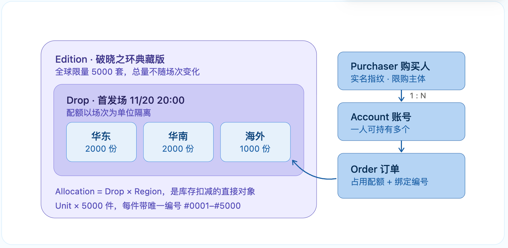

# 限量编号藏品发售系统 · 规格说明

状态：草案

## 问题陈述

游戏发行商自营平台每次发售限量典藏版，开售那一秒会有几十万人同时点。现有的单体架构撑不住，数据库连接池打满，页面直接白屏。真实用户抢不到，用脚本的黄牛却能开几十个小号批量锁单，转头在二手平台加价卖。

需要一套在开售洪峰下不超卖、不重复、也不让脚本占便宜的发售能力。被抢空之后，真实用户还应该有第二次机会。

## 解决方案

一套以配额为中心的发售系统。用户点抢占，Redis 用一段 Lua 脚本原子地做三件事：扣配额、查限购、取编号。成功就异步落库，给出 15 分钟支付窗口。

超时没付的配额不马上放回去，压 30 分钟再释放。否则黄牛可以锁单、放弃、盯着库存回升，白拿一份真实剩余量的情报。

## 用户故事

1. 作为玩家，我想在发售页看到版本信息、限量总数和当前剩余份数，好判断值不值得抢。
2. 作为玩家，我想在开售前看到倒计时，别错过那一秒。
3. 作为玩家，我想点完抢占立刻知道成没成，而不是对着转圈等。
4. 作为玩家，我想在抢到的一刻就看到自己的收藏编号。
5. 作为玩家，我想有 15 分钟付款，网络卡一下不至于白抢。
6. 作为玩家，我想在超时前收到提醒，别把付款忘了。
7. 作为玩家，我想知道售罄之后还会不会有回流批次，省得一直刷新。
8. 作为玩家，我想在回流释放时被通知到。
9. 作为玩家，我想看到自己所有已支付的藏品和编号。
10. 作为玩家，我想看到待支付订单还剩多少时间，好决定要不要继续。
11. 作为玩家，我想能主动取消待支付订单，不占着名额。
12. 作为玩家，我在同一版本下只能拿到一件，用几个账号都一样。
13. 作为玩家，我想支付成功后藏品立刻进"我的藏品"，不用等。
14. 作为玩家，我想在大区售罄时看到其他大区的库存，好判断要不要换归属。
15. 作为运营，我想创建版本并设定全球限量总数。
16. 作为运营，我想给一个版本开多个场次，每个场次按大区分配配额。
17. 作为运营，我想在开售前校验各大区配额之和不超过版本限量，别配错了才发现。
18. 作为运营，我想能手动触发一次回流释放，异常时好干预。
19. 作为运营，我想看到每个场次实时的可售、占用、待回流、已售份数。
20. 作为运营，我想在发现异常账号时封掉它的购买资格。
21. 作为运维，我想在数据库故障时让系统降级成只读，而不是全线崩。
22. 作为运维，我想看到抢购链路的 P99 延迟和失败原因分布。
23. 作为第三方支付网关，我想通过幂等回调确认支付结果，重复回调不会重复发货。
24. 作为系统，我想在缓存删除失败后自动重试，别让脏数据长期留在缓存里。
25. 作为系统，我想在配额回收到释放的窗口里，对外不暴露这部分数量。

## 实现决策

### 技术点映射

七项原始要求的落地位置，实现和复盘时对照这张表：

| 要求 | 落地点 |
|---|---|
| Redis + Lua 库存扣减与一人一单，防超卖 | 抢占接口里那段三合一脚本 |
| RocketMQ 异步解耦下单流程，削峰 | 抢占成功后异步落库，消费者限速 |
| 逻辑过期防缓存击穿 | 版本详情、场次详情的读路径 |
| 缓存空值防缓存穿透 | 版本详情查不到 ID 时写空标记 |
| 更新 DB 后删缓存，失败 MQ 补偿 + TTL 兜底 | 版本和场次信息的写路径 |
| Redis + AOP + 注解滑动窗口限流，多维度 | 抢占接口、登录接口的切面 |
| 延迟队列做分钟级定时任务，超时关单释放库存 | 超时关单和回流释放 |
| 乐观锁解决支付回调与超时关单并发 | 订单状态流转 |

### 领域分层



版本（Edition）管限量总数。场次（Drop）管开售时间，一次开售就是一个场次。配额（Allocation）是场次和大区的交叉记录，扣减只发生在这一层。藏品件（Unit）带唯一编号，开售前就预生成好。

Unit 上直接记 `owner_purchaser_hash`，支付成功时从 `OCCUPIED` 翻成 `OWNED`，不靠订单表反查。因为抢占和支付之间隔着一段"号锁了但钱还没付"的时间，只靠订单视角说不清这段状态。代价是 Unit 和 Order 的状态得由同一个状态机驱动，不能各改各的。

### 表结构

所有表用 `t_` 前缀。`drop` 和 `order` 都是 MySQL 保留字。

```
t_edition       (id, name, total_limit, cover_url, description, status, created_at, updated_at)
t_drop          (id, edition_id, name, start_at, end_at, status, created_at)
t_allocation    (id, drop_id, region, total, available, occupied, pending_repool, sold,
                 version, created_at, updated_at)
t_account       (id, username, password_hash, real_name_hash, region, status, created_at)
t_unit          (id, edition_id, collectible_number, status, owner_purchaser_hash,
                 order_id, version, created_at)
t_order         (id, order_no, account_id, purchaser_hash, edition_id, drop_id,
                 allocation_id, unit_id, collectible_number, amount, status,
                 close_reason, version, created_at, paid_at, closed_at)
t_payment       (id, order_id, channel, trade_no, amount, status, raw_payload, created_at)
```

枚举取值：

- `t_unit.status`：`AVAILABLE` 可售、`OCCUPIED` 被待支付订单占用、`OWNED` 已归属、`VOID` 作废（编号不复用）。
- `t_order.status`：`PENDING_PAYMENT`、`PAID`、`CLOSED`、`REFUNDED`。
- `t_order.close_reason`：`TIMEOUT`、`CANCELLED`。

关键约束：

- `t_unit` 上 `(edition_id, collectible_number)` 唯一索引，编号唯一靠它兜底。
- `t_order` 上 `(purchaser_hash, edition_id)` 唯一索引，限购靠它兜底。`edition_id` 在订单表里是刻意冗余的，只为支撑这个索引，同一版本跨场次也不能重复。缺了它这个索引根本建不起来。
- `t_payment` 上 `trade_no` 唯一索引，回调幂等靠它兜底。
- `t_allocation` 的 `available + occupied + pending_repool + sold = total` 要恒成立。定时对账，对不上就告警。
- 所有可变表带 `version` 字段。

### Redis 键设计

```
alloc:stock:{dropId}:{region}      string  可用份数
alloc:pool:{dropId}:{region}       list    可用编号，LPOP 取出
limit:{editionId}:{realNameHash}   string  抢占成功时写入 orderNo，限购标记
miss:{editionId}:{realNameHash}    string  未支付导致的失格计数
unit:owner:{unitId}                string  归属缓存，与 t_unit 同步
edition:detail:{editionId}         string  版本详情，JSON 内含逻辑过期时间
drop:detail:{dropId}               string  场次详情，同上
```

限购键挂在 `editionId` 而不是 `dropId` 上，因为额度属于版本，不属于某一场（见 ADR-0002）。

限购键什么时候删，是这套设计里最容易想漏的一处。订单关闭时不能立刻删：黄牛锁一单、放弃、再锁一单，每次都能重新拿到配额，等于白送他反复试探的机会。所以关闭时不删键，改为累加 `miss` 计数。同一实名 24 小时内累计 3 次未支付，本版本永久失格；不到 3 次的，最后一次关闭后 24 小时自动恢复。手滑一次的人还有机会，脚本化的反复试探会在第 3 次被钉死。

### 抢占脚本

一段脚本干完三件事，任何一步不满足都不留痕迹。顺序上先全校验、后统一写，取编号必须排在写操作之前，否则会出现"库存扣了、号没拿到"。

```lua
-- KEYS[1] alloc:stock:{dropId}:{region}
-- KEYS[2] alloc:pool:{dropId}:{region}
-- KEYS[3] limit:{editionId}:{realNameHash}
-- ARGV[1] orderNo
local stockKey, poolKey, limitKey = KEYS[1], KEYS[2], KEYS[3]

if redis.call('EXISTS', limitKey) == 1 then
  return {-1, ''}
end

local stock = tonumber(redis.call('GET', stockKey) or '-1')
if stock < 1 then
  return {-2, ''}
end

local number = redis.call('LPOP', poolKey)
if not number then
  return {-3, ''}
end

redis.call('DECR', stockKey)
redis.call('SET', limitKey, ARGV[1])
return {0, number}
```

返回码：`0` 成功并带回编号，`-1` 已购，`-2` 售罄，`-3` 编号池异常。`-3` 说明库存和编号池不同步，属于配置错误，要告警，不能当成普通售罄咽下去。

编号池里存 `unitId:number` 复合串，不存裸编号。落库时能直接按主键更新 `t_unit`，省一次按编号查表。

脚本成功但消息没发出去，执行反向脚本回滚：`INCR stock`、`RPUSH pool`、`DEL limit`。反向脚本用的必须是同样的三个键，否则会回滚出一半。

### 消息拓扑

两个 Topic，语义用 Tag 区分，运维面小一点。

```
Topic: release-drop
  Tag: order-created    抢占成功后的落库（普通消息）
  Tag: order-timeout    延迟 15 分钟，关单
  Tag: repool-release   延迟 30 分钟，把 pending_repool 释放回 available

Topic: cache-evict
  Tag: evict-retry      缓存删除失败的补偿重试，最多 5 次，指数退避
```

延迟消息走 RocketMQ 5.x 的定时消息，任意时刻都能定，不依赖 4.x 那 18 个固定级别。

落库消费者要限速，单机并发不超过 20。不然异步削峰省下来的余量，会被 DB 写入原样还回去。

### 缓存防护

击穿这一侧，`edition:detail:{id}` 和 `drop:detail:{id}` 都用逻辑过期。JSON 里带 `expireAt`，物理上不过期。读到逻辑过期就返回旧值，同时起一个线程异步重建，重建前用 `SETNX` 抢锁，防止几个线程同时重建。

不用互斥等待，是因为开售那一秒的读请求里，宁可给用户一个 2 秒前的库存数字，也不能让他排队。

穿透这一侧，查不到的 `editionId` 直接写空标记，值 `__NULL__`，TTL 60 秒。这个 TTL 必须明显短于正常缓存，否则新建的版本会在最长 30 分钟里查不到。

一致性走固定路径：更新数据库、删缓存，删失败就投 `cache-evict` 补偿。没做延迟双删，因为跨节点延迟控制不住，而 MQ 补偿看得见、能重试。所有缓存键额外挂 30 分钟 TTL 兜底。

### 限流

注解加 AOP，滑动窗口用 ZSET。

```java
@RateLimit(dimensions = {GLOBAL, IP, USER},
           limit = 100, windowSeconds = 1, fallback = REJECT)
```

`GLOBAL` 用固定键，`IP` 用客户端地址，`USER` 用登录态账号。多个维度全过了才放行，任何一个超限就拒，拒绝时把最早恢复时间返回去。未登录时 `USER` 维度自动跳过，由 `IP` 兜底，不能因为取不到用户就把整个维度废掉。

清理、计数、写入必须在同一个 Lua 里做完，否则并发下窗口边界会飘。

```lua
-- KEYS[1] 窗口键  ARGV[1] 当前毫秒  ARGV[2] 窗口长度  ARGV[3] 上限  ARGV[4] 成员
redis.call('ZREMRANGEBYSCORE', KEYS[1], 0, ARGV[1] - ARGV[2])
if redis.call('ZCARD', KEYS[1]) >= tonumber(ARGV[3]) then
  return 0
end
redis.call('ZADD', KEYS[1], ARGV[1], ARGV[4])
redis.call('PEXPIRE', KEYS[1], ARGV[2])
return 1
```

ZSET 成员要用请求 ID，不能拿时间戳。同一毫秒的并发请求会被 ZSET 去重，计数就少了。

### 订单状态机

```
PENDING_PAYMENT ──支付成功──> PAID
       │
       ├──超时 15 分钟──> CLOSED (TIMEOUT)
       └──用户取消──────> CLOSED (CANCELLED)
```

`PAID` 之后还允许 `REFUNDED`。状态流转一律走乐观锁：

```
UPDATE t_order SET status = ?, version = version + 1
WHERE id = ? AND status = 'PENDING_PAYMENT' AND version = ?
```

影响行数为 0 就当并发失败处理，不重试，直接按当前状态往下走。

两个方向撞车的结果不一样。关单先成、支付回调后到：订单已经 `CLOSED`，钱却收了，必须转自动退款，`close_reason` 记 `TIMEOUT`。这是整个系统里唯一会让用户不满的分支，得显式处理，不能吞掉。支付回调先成、关单消息后到：消费者读到状态不是 `PENDING_PAYMENT`，直接跳过，什么都不做。

支付回调按 `trade_no` 幂等，重复回调返回成功，但不重复发货。

### 接口契约

```
POST /api/drops/{dropId}/claim          抢占，返回 orderNo 与收藏编号
GET  /api/editions/{editionId}          版本详情，缓存击穿/穿透防护点
GET  /api/drops/{dropId}                场次详情，含分大区剩余份数
GET  /api/orders/{orderNo}              订单详情，含剩余支付秒数
POST /api/orders/{orderNo}/cancel       主动取消
POST /api/orders/{orderNo}/pay          发起支付（模拟网关）
POST /api/payment/callback              支付回调，需幂等
GET  /api/me/units                      我的藏品
POST /api/admin/editions                创建版本
POST /api/admin/drops                   创建场次
POST /api/admin/allocations             配置配额，校验总和不超过限量
POST /api/admin/drops/{id}/repool       手动触发回流
GET  /api/admin/drops/{id}/stats        实时统计
```

抢占接口成功时要在 200ms 内返回，响应里带收藏编号，用户就是要在这一刻看到自己是几号。

## 测试决策

测试全部打在 HTTP 接口层，不碰 Service 内部方法。整条链路对不对，从接口的输入输出就能看出来：抢占返回的编号、订单状态、藏品归谁。这样重构内部实现时测试不会碎。

并发正确性测试是重点。`CountDownLatch` 起 1000 个线程抢 100 份配额，断言成功数恰好 100、`t_unit` 里 `OCCUPIED` 恰好 100 条、编号不重复、`available` 归零、守恒式成立。这是唯一能证明"没有超卖"的测试，必须进 CI。

限购测试覆盖三种情况：同一实名下两个账号先后抢，第二次返回已购；不同实名各自成功；同一实名累计 3 次未支付后，第 4 次被拒。

状态机竞争测试并发触发支付回调和关单消息，断言最终状态只有两种合法终局，不会出现"已关闭、钱收了、也没退款"的静默状态。

基础设施用 Testcontainers 拉 MySQL、Redis、RocketMQ，不依赖本地环境，换台机器也能跑。

## 范围外

- 实物发货、物流、地址管理。系统止于"支付成功且藏品归属确立"。
- 真实支付网关对接，用模拟网关替代，重点在回调幂等和状态机。
- 实名认证的合规流程，只存指纹，不存原文。
- 微服务拆分与分布式事务。本项目是单体应用，所有一致性在同一进程内解决。
- 客服申诉通道。被实名限购误拦的用户在本项目里直接失败。

## 补充说明

规模上定全球限量 5000 套，分三个大区，华东 2000、华南 2000、海外 1000。压测目标以实测为准，报告里如实写硬件和并发模型，不虚报 QPS。验收线是抢占接口在峰值压力下 P99 低于 150ms，全程零超卖。

不做独立回流场次的理由见 ADR-0003。轻量回流的模型代价只有一个 `pending_repool` 状态加一条延迟消息，完整场次转移则要重写配额归属。

面试最容易被追问的三处：为什么扣配额和取编号必须在一个脚本里；为什么限购键挂在版本而不是场次；关单赢了支付回调之后钱怎么办。这三问答不出来，说明只是背过概念。
