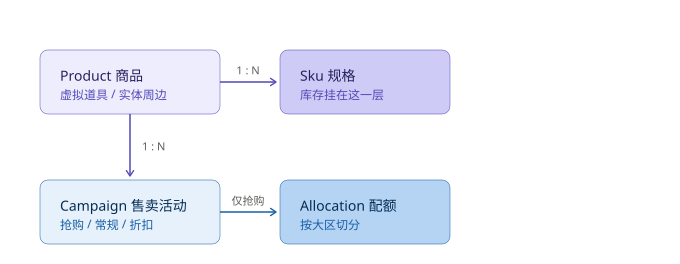
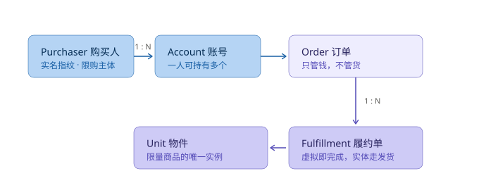

# Sunshine-FPS 规格说明

状态：草案

## 问题陈述

虚构 FPS 游戏的官方商城每次发售限量道具，开售那一秒会有几十万人同时点。现有的单体架构撑不住，数据库连接池打满，页面直接白屏。真实玩家抢不到，用脚本的黄牛却能开几十个小号批量锁单，转头在二手平台加价卖。

商城还卖两类别的东西：常驻的普通道具和周边，随时能买；限时打折的商品，价格便宜但流量极大，详情页同样被打爆。

玩家需要一个地方看公告、看活动、抢限量、买常规、查自己有什么。运营需要一个后台把这些东西配上。

## 解决方案

商品只是「是什么」，售卖方式由 Campaign 决定。三种卖法是三份 Campaign 配置，不是三套商品代码。





限时抢购走 Redis 的 Lua 原子扣减，普通和折扣售卖走数据库乐观锁。两条路径并存是刻意的：前者要扛住瞬时洪峰，后者要保证常规交易的简单与可靠。

订单只管钱，货由履约单管。一个订单里既有皮肤又有手办时，拆成两张履约单，虚拟的支付即完成，实体的走发货。

## 用户故事

### 浏览

1. 作为玩家，我想在商城首页看到分类和推荐商品，好快速找到想要的东西。
2. 作为玩家，我想看到商品详情、价格、库存状态，好判断值不值得买。
3. 作为玩家，我想看到即将开售的限量商品和倒计时，好提前蹲点。
4. 作为玩家，我想在热门商品页快速打开，而不是转圈等到超时。
5. 作为玩家，我想看到商品有哪些规格可选，比如尺码和颜色。
6. 作为玩家，我想看到限时折扣还剩多久结束，好决定要不要现在买。

### 限时抢购

7. 作为玩家，我想在开售前预约，并在开售前 10 分钟收到提醒。
8. 作为玩家，我想点完抢购立刻知道成没成，而不是对着转圈等。
9. 作为玩家，我想在抢到的一刻就看到自己的收藏编号。
10. 作为玩家，我想有 15 分钟付款，网络卡一下不至于白抢。
11. 作为玩家，我在同一件商品上只能拿到一件，用几个账号都一样。
12. 作为玩家，我想知道售罄之后还会不会有回流，省得一直刷新。
13. 作为玩家，我想在大区售罄时看到其他大区的库存。

### 常规与折扣购买

14. 作为玩家，我想直接买常驻道具，选好规格就能下单。
15. 作为玩家，我想买限时折扣的商品，价格按折扣算。
16. 作为玩家，我想一次买多件同款周边，比如买三件送人。
17. 作为玩家，我想看到订单里运费是多少，以及还差多少能包邮。
18. 作为玩家，我想保存收货地址，下次不用重填。

### 支付与履约

19. 作为玩家，我想在支付成功后立刻看到虚拟道具进了我的道具库。
20. 作为玩家，我想看到实体周边的发货状态和物流单号。
21. 作为玩家，我想在收到货后确认签收。
22. 作为玩家，我想对还没发货的周边申请退款，不用联系客服。
23. 作为玩家，我想在收到货不满意时也能申请退货。
24. 作为玩家，我想看到退款申请处理到哪一步了。
25. 作为玩家，我想主动取消还没付款的订单。
26. 作为玩家，我想看到待支付订单还剩多少秒。
27. 作为玩家，我想看到自己所有已拥有的道具和藏品，包括编号。

### 内容

28. 作为玩家，我想看到官方公告，比如维护安排。
29. 作为玩家，我想看到运营活动，有时间的活动能显示还剩几天。
30. 作为玩家，我想从活动页直接跳到关联的商品，不用自己找。
31. 作为玩家，我想看到公告和活动按时间倒序排列。

### 运营

32. 作为运营，我想创建商品并设定是虚拟还是实体、限不限量、限不限购。
33. 作为运营，我想给商品配多个规格，各自设库存。
34. 作为运营，我想创建 Campaign，选限时抢购、常规售卖或限时折扣。
35. 作为运营，我想给限时抢购按大区分配配额，并校验总和不超过限量。
36. 作为运营，我想设置运费模板：首件多少、续件多少、满多少包邮。
37. 作为运营，我想手动触发一次回流释放。
38. 作为运营，我想看到每个 Campaign 实时的可售、占用、待回流、已售。
39. 作为运营，我想发公告和活动，活动可以挂一个折扣 Campaign。
40. 作为运营，我想在发货后填物流单号。
41. 作为运营，我想审核退款申请，确认收到退货后发起退款。

### 系统

42. 作为第三方支付网关，我想通过幂等回调确认支付结果，重复回调不会重复发货。
43. 作为支付网关，我想通过幂等回调确认退款结果，重复回调不会重复退款。
44. 作为系统，我想在缓存删除失败后自动重试，别让脏数据长期留在缓存里。
45. 作为系统，我想在配额回收到释放的窗口里，对外不暴露这部分数量。
46. 作为运维，我想看到抢购链路的 P99 延迟和失败原因分布。
47. 作为运维，我想在数据库故障时系统降级为只读，而不是全线崩溃。

## 实现决策

### 技术点映射

| 要求 | 落点 |
|---|---|
| Redis + Lua 库存扣减与一人一单，防超卖 | 限时抢购的抢占接口，单脚本三合一 |
| RocketMQ 异步解耦下单流程，削峰 | 抢购成功后的落库异步化，消费者限速 |
| 逻辑过期防缓存击穿 | 商品详情、Campaign 详情、公告详情 |
| 缓存空值防缓存穿透 | 商品详情收到不存在的 ID |
| 更新 DB 后删缓存，失败 MQ 补偿 + TTL 兜底 | 商品、Campaign、公告的写路径 |
| Redis + AOP + 注解滑动窗口限流 | 抢占接口与商品详情接口 |
| 延迟队列做分钟级定时任务 | 超时关单、回流释放、预约提醒，三条链路 |
| 乐观锁 | 支付回调与关单的竞争，以及普通商品的库存扣减 |
| 回调幂等 | 支付与退款两条回调共用一套骨架，只是幂等键不同 |

### 领域分层

Product 是一件商品，带不限量或限量的总量。Sku 是它的可售单位，库存挂在 Sku 上，虚拟道具只有一个默认 Sku。Campaign 是一次售卖，有类型和时间窗。Flash Sale 类型的 Campaign 额外有 Allocation，也就是按大区切的配额。

Unit 只属于限量商品，带唯一编号，开售前预生成。不限量商品不生成 Unit。

订单和履约分开。Order 记钱，Fulfillment 记货。一个订单按商品形态拆成一张或两张履约单。

### 表结构

所有表用 `t_` 前缀。

```
t_product      (id, name, kind, cover_url, description, total_limit, purchase_limit,
                status, created_at, updated_at)
t_sku          (id, product_id, name, attrs, price, stock, version, created_at, updated_at)
t_campaign     (id, name, type, product_id, start_at, end_at, discount_price,
                status, created_at, updated_at)
t_allocation   (id, campaign_id, region, total, available, occupied, pending_repool, sold,
                version, created_at, updated_at)
t_unit         (id, product_id, collectible_number, status, owner_purchaser_hash,
                campaign_id, order_id, version, created_at)
t_reserve      (id, campaign_id, account_id, purchaser_hash, created_at)
t_order        (id, order_no, account_id, purchaser_hash, amount, freight, status,
                close_reason, version, created_at, paid_at, closed_at)
t_order_item   (id, order_id, product_id, sku_id, campaign_id, unit_id,
                collectible_number, quantity, unit_price, purchaser_hash, limit_flag)
t_fulfillment  (id, order_id, kind, status, address_id, tracking_no,
                shipped_at, signed_at, version, created_at)
t_address      (id, account_id, receiver, phone, province, city, district, detail, is_default)
t_payment      (id, order_id, channel, trade_no, amount, status, raw_payload, created_at)
t_refund       (id, refund_no, order_id, fulfillment_id, account_id, type, reason,
                status, amount, tracking_no, reject_reason, version,
                created_at, approved_at, received_at, refunded_at)
t_announcement (id, title, body, pinned, status, published_at)
t_event        (id, title, cover_url, body, start_at, end_at, campaign_id, status)
t_freight_tpl  (id, first_unit_fee, additional_unit_fee, free_threshold, updated_at)
```

枚举取值：

- `t_product.kind`：`VIRTUAL` 虚拟道具、`PHYSICAL` 实体周边。
- `t_campaign.type`：`FLASH` 限时抢购、`NORMAL` 常规售卖、`DISCOUNT` 限时折扣。
- `t_unit.status`：`AVAILABLE`、`OCCUPIED`、`OWNED`、`VOID`。
- `t_order.status`：`PENDING_PAYMENT`、`PAID`、`CLOSED`、`REFUNDED`。
- `t_fulfillment.status`：虚拟为 `PENDING`、`COMPLETED`，实体为 `PENDING`、`SHIPPED`、`SIGNED`。
- `t_refund.type`：`USER_REQUEST` 用户申请、`SYSTEM_AUTO` 系统自动发起。
- `t_refund.status`：`REQUESTED`、`APPROVED`、`REFUNDED`、`REJECTED`。

关键约束：

- `t_unit` 上 `(product_id, collectible_number)` 唯一索引，编号唯一靠它兜底。
- `t_sku` 带 `version`，普通商品的库存扣减靠它做乐观锁。
- `t_allocation` 的 `available + occupied + pending_repool + sold = total` 要恒成立，定时对账。
- `t_payment` 上 `trade_no` 唯一索引，回调幂等靠它兜底。
- `t_refund` 上 `refund_no` 唯一索引，退款回调幂等靠它兜底。同时限制同一 `fulfillment_id` 只能存在一条未终态的退款单，防止重复申请。

限购的唯一性兜底放在 `t_order_item` 上，用了 MySQL 唯一索引对 NULL 的处理方式：

```
UNIQUE KEY uk_purchase (purchaser_hash, product_id, limit_flag)
```

需要限购的商品，`limit_flag` 写 `1`，同一个购买人同一件商品只能存在一行。不限购的商品，`limit_flag` 写 `NULL`，而 MySQL 的唯一索引允许多行 NULL，所以能买任意多件。这个字段不参与任何业务查询，只为承担唯一性。

### Redis 键设计

```
alloc:stock:{campaignId}:{region}    string  配额可用份数
alloc:pool:{campaignId}:{region}     list    可用编号，存 unitId:number 复合串
limit:{productId}:{realNameHash}     string  限购标记，抢占成功时写入 orderNo
miss:{productId}:{realNameHash}      string  未支付导致的失格计数
product:detail:{productId}           string  商品详情，JSON 内含逻辑过期时间
campaign:detail:{campaignId}         string  活动详情，同上
announcement:detail:{id}             string  公告详情，同上
```

限购键挂 `productId` 而不是 `campaignId`，因为额度属于商品，同一件商品先后参加多场 Campaign 要累计（见 ADR-0002）。

限购键什么时候删，是这套设计里最容易想漏的一处。订单关闭时不能立刻删：黄牛锁一单、放弃、再锁一单，每次都能重新拿到配额。所以关闭时不删键，改为累加 `miss` 计数。同一实名 24 小时内累计 3 次未支付，本商品永久失格；不到 3 次的，最后一次关闭后 24 小时自动恢复。

### 抢购脚本

限时抢购走这一段，三个动作在同一个脚本里完成。顺序上先全校验、后统一写，取编号排在写操作之前，否则会出现"库存扣了、号没拿到"。

```lua
-- KEYS[1] alloc:stock:{campaignId}:{region}
-- KEYS[2] alloc:pool:{campaignId}:{region}
-- KEYS[3] limit:{productId}:{realNameHash}
-- ARGV[1] orderNo
local stockKey, poolKey, limitKey = KEYS[1], KEYS[2], KEYS[3]

if redis.call('EXISTS', limitKey) == 1 then
  return {-1, ''}
end

local stock = tonumber(redis.call('GET', stockKey) or '-1')
if stock < 1 then
  return {-2, ''}
end

local unit = redis.call('LPOP', poolKey)
if not unit then
  return {-3, ''}
end

redis.call('DECR', stockKey)
redis.call('SET', limitKey, ARGV[1])
return {0, unit}
```

返回码：`0` 成功并带回 `unitId:number`，`-1` 已购，`-2` 售罄，`-3` 编号池异常。`-3` 说明配额和编号池不同步，属于配置错误，要告警，不能当成普通售罄咽下去。

编号池里存 `unitId:number` 复合串，落库时能直接按主键更新 `t_unit`，省一次按编号查表。

脚本成功但消息没发出去，执行反向脚本回滚：`INCR stock`、`RPUSH pool`、`DEL limit`。反向脚本用的必须是同样的三个键，否则会回滚出一半。

### 两条下单路径

这是本项目里唯一一处刻意保留两条实现的地方，因为它们的约束真的不同。

**限时抢购**：Lua 扣配额并取编号，成功后发消息，立即返回订单号和编号。落库由消费者完成，单机并发不超过 20。用户在 200ms 内拿到结果，数据库只承担 5000 次写入而不是 50 万次点击。

**普通与折扣售卖**：同步事务。`UPDATE t_sku SET stock = stock - ?, version = version + 1 WHERE id = ? AND stock >= ? AND version = ?`，影响行数为 0 就是库存不足或并发失败，直接返回。

前者要的是洪峰下的确定性，后者要的是常规交易的简单。强行统一只会两边都不讨好。

### 消息拓扑

```
Topic: sunshine-order
  Tag: flash-created     抢购落库（普通消息）
  Tag: order-timeout     延迟 15 分钟，关单
  Tag: repool-release    延迟 30 分钟，把 pending_repool 释放回 available
  Tag: reserve-remind    定时到开售前 10 分钟，提醒该场的预约用户

Topic: sunshine-cache
  Tag: evict-retry       缓存删除失败的补偿重试，最多 5 次，指数退避
```

三条延迟链路语义完全不同，共用一条通道。延迟消息走 RocketMQ 5.x 的定时消息，任意时刻都能定。

预约提醒不能按人发消息。一场 Campaign 有十万人预约就发十万条消息，光消息堆积就能把 Broker 打满。做法是按场次发一条：Campaign 创建时投递一条指向开售前 10 分钟的定时消息，消费者拿到 `campaignId` 后分批查出预约用户，再写站内信。一条消息代替十万条，而且预约用户中途增减都不影响。

### 缓存防护

击穿这一侧，商品详情、Campaign 详情、公告详情都用逻辑过期。JSON 里带 `expireAt`，物理上不过期。读到逻辑过期就返回旧值，同时起一个线程异步重建，重建前用 `SETNX` 抢锁，防止几个线程同时重建。

不用互斥等待，是因为开售那一秒的读请求里，宁可给用户一个 2 秒前的库存数字，也不能让他排队。

穿透这一侧，查不到的商品 ID 直接写空标记，值 `__NULL__`，TTL 60 秒。这个 TTL 必须明显短于正常缓存，否则新上架的商品会在最长 30 分钟里查不到。

一致性走固定路径：更新数据库、删缓存，删失败就投 `cache-evict` 补偿。没做延迟双删，因为跨节点延迟控制不住，而 MQ 补偿看得见、能重试。所有缓存键额外挂 30 分钟 TTL 兜底。

### 限流

注解加 AOP，滑动窗口用 ZSET。

```java
@RateLimit(dimensions = {GLOBAL, IP, USER},
           limit = 100, windowSeconds = 1, fallback = REJECT)
```

`GLOBAL` 用固定键，`IP` 用客户端地址，`USER` 用登录态账号。多个维度全过了才放行，任何一个超限就拒，拒绝时把最早恢复时间返回去。未登录时 `USER` 维度自动跳过，由 `IP` 兜底，不能因为取不到用户就把整个维度废掉。

清理、计数、写入必须在同一个 Lua 里做完，否则并发下窗口边界会飘。

```lua
-- KEYS[1] 窗口键  ARGV[1] 当前毫秒  ARGV[2] 窗口长度  ARGV[3] 上限  ARGV[4] 成员
redis.call('ZREMRANGEBYSCORE', KEYS[1], 0, ARGV[1] - ARGV[2])
if redis.call('ZCARD', KEYS[1]) >= tonumber(ARGV[3]) then
  return 0
end
redis.call('ZADD', KEYS[1], ARGV[1], ARGV[4])
redis.call('PEXPIRE', KEYS[1], ARGV[2])
return 1
```

ZSET 成员要用请求 ID，不能拿时间戳。同一毫秒的并发请求会被 ZSET 去重，计数就少了。

### 订单状态机

```
PENDING_PAYMENT ──支付成功──> PAID
       │
       ├──超时 15 分钟──> CLOSED (TIMEOUT)
       └──用户取消──────> CLOSED (CANCELLED)
```

`PAID` 之后还允许 `REFUNDED`。状态流转一律走乐观锁：

```
UPDATE t_order SET status = ?, version = version + 1
WHERE id = ? AND status = 'PENDING_PAYMENT' AND version = ?
```

影响行数为 0 就当并发失败处理，不重试，直接按当前状态往下走。

两个方向撞车的结果不一样。关单先成、支付回调后到：订单已经 `CLOSED`，钱却收了，必须转自动退款。这是整个系统里唯一会让用户不满的分支，得显式处理，不能吞掉。支付回调先成、关单消息后到：消费者读到状态不是 `PENDING_PAYMENT`，直接跳过。

支付回调按 `trade_no` 幂等，重复回调返回成功，但不重复发货。

### 履约状态机

```
虚拟：PENDING ──支付成功──> COMPLETED
实体：PENDING ──发货──> SHIPPED ──签收──> SIGNED
```

虚拟履约单在支付成功的同一个事务里完成，不能异步，否则用户付完钱打开道具库是空的。

实体履约单的 `PENDING` 是待发货，运营填物流单号后转 `SHIPPED`，用户确认后转 `SIGNED`。签收不做自动超时确认，那需要一套定时任务和争议处理，不属于本项目。

### 退款状态机

```
REQUESTED ──运营同意──> APPROVED ──确认收到货并退款──> REFUNDED
    │
    └──运营驳回──> REJECTED
```

退款的作用对象是履约单，不是订单（见 ADR-0007）。虚拟履约单不接用户申请，只有关单赢了支付回调时产生的 `SYSTEM_AUTO` 退款。

`SYSTEM_AUTO` 跳过 `APPROVED` 直接进 `REFUNDED`，因为那是系统自己的错，没有审核的必要。这条捷径只对自动退款开放，用户申请的每一条都要过人。

未发货的退款在 `APPROVED` 之后直接退；已发货的要等运营在后台确认收到退货，`received_at` 记下时间再退。同一个 `APPROVED` 状态覆盖两种情况，靠 `received_at` 是否为空区分，不再多设一个状态。

退款金额只含商品金额，运费不退。部分退款时订单保持 `PAID`，只有全额退款才把订单转成 `REFUNDED`。

### 运费计算

只对实体部分计费。算法是取订单里所有 `kind = PHYSICAL` 的明细，算出实体商品总额和总件数；总额达到包邮门槛就免运费，否则按首件加续件算。

虚拟商品既不计入件数，也不计入包邮门槛。一个订单里只有虚拟商品时运费恒为 0。

这么定是因为虚拟商品没有物流成本。让它参与门槛计算，就会出现买一个 99 块的皮肤，把同一单里 5 块钱的徽章也带成包邮，运费规则就白设了。

### 接口契约

```
GET  /api/products                    商品列表，支持分类与分页
GET  /api/products/{id}               商品详情，击穿与穿透的防护点
GET  /api/campaigns/{id}              活动详情，含分大区实时剩余
GET  /api/campaigns/upcoming          即将开售的场次
POST /api/campaigns/{id}/claim        抢购，返回订单号与编号
POST /api/campaigns/{id}/reserve      预约
DELETE /api/campaigns/{id}/reserve    取消预约
POST /api/orders                      直接下单，用于常规与折扣
GET  /api/orders/{orderNo}            订单详情，含剩余支付秒数
POST /api/orders/{orderNo}/cancel     取消
POST /api/orders/{orderNo}/pay        发起支付
POST /api/payment/callback            支付回调，需幂等
POST /api/refunds                     申请退款，指定 fulfillmentId
GET  /api/refunds/{refundNo}          退款详情
POST /api/refund/callback             退款回调，需幂等
GET  /api/fulfillments                我的履约单
GET  /api/me/items                    我的道具库与藏品
GET  /api/addresses                   收货地址
POST /api/addresses                   新增地址
GET  /api/announcements               公告列表
GET  /api/announcements/{id}          公告详情
GET  /api/events                      活动列表
GET  /api/events/{id}                 活动详情
POST /api/admin/products              创建商品
POST /api/admin/skus                  配置规格与库存
POST /api/admin/campaigns             创建 Campaign
POST /api/admin/allocations           配置配额，校验总和不超过限量
POST /api/admin/campaigns/{id}/repool 手动触发回流
POST /api/admin/fulfillments/{id}/ship 发货
POST /api/admin/refunds/{id}/approve  同意退款
POST /api/admin/refunds/{id}/receive  确认收到退货并发起退款
POST /api/admin/refunds/{id}/reject   驳回退款
POST /api/admin/announcements         发布公告
POST /api/admin/events                发布活动
GET  /api/admin/campaigns/{id}/stats  实时统计
```

抢占接口成功时要在 200ms 内返回，响应里带收藏编号。

## 测试决策

测试全部打在 HTTP 接口层，不碰 Service 内部方法。整条链路对不对，从接口的输入输出就能看出来：抢购返回的编号、订单状态、履约状态、归属。这样重构内部实现时测试不会碎。

并发正确性测试是重点。`CountDownLatch` 起 1000 个线程抢 100 份配额，断言成功数恰好 100、`t_unit` 里 `OCCUPIED` 恰好 100 条、编号不重复、`available` 归零、守恒式成立。这是唯一能证明"没有超卖"的测试，必须进 CI。

限购测试覆盖四种情况：同一实名下两个账号先后抢，第二次返回已购；不同实名各自成功；同一商品跨两场 Campaign 累计，抢过首发的人在回流场被拒；同一实名累计 3 次未支付后第 4 次被拒。

两条下单路径的一致性测试。同样的 SKU 库存，一个请求走抢购、一个走直接下单，并发 100 次之后库存不能变成负数。这条容易漏，因为两条路径的扣减代码完全不同。

混合订单测试。一单里同时有虚拟和实体，断言拆出两张履约单、虚拟那张立刻 `COMPLETED`、运费只按实体部分算。

状态机竞争测试。并发触发支付回调与关单消息，断言最终状态只有两种合法终局，不会出现"已关闭、钱收了、也没退款"的静默状态。

退款测试覆盖三件事：虚拟履约单提交退款申请被拒；已发货的实体履约单走完申请、同意、确认收货、退款全程；同一履约单重复申请被未终态约束挡住。

退款回调的幂等单独测一次，和支付回调对称。同一个 `refund_no` 回调五次，只产生一条退款记录，钱只退一次。

基础设施用 Testcontainers 拉 MySQL、Redis、RocketMQ，不依赖本地环境。

## 范围外

- 真实支付网关对接，用模拟网关替代，重点在回调幂等和状态机。
- 真实物流 API，物流单号只存字符串。
- 退货的物流跟踪与验货判定。退货走运营人工确认收货，不接快递单号查询，也不做验货不通过后的二次寄回。
- 玩家发帖、视频、评论。社区只有官方内容。
- 购物车。所有商品都是"立即购买"。
- 实名认证的合规流程，只存指纹。
- 微服务拆分与分布式事务，单体应用所有一致性在同一进程内解决。

## 补充说明

规模上定一场限时抢购 5000 份，分三个大区，华东 2000、华南 2000、海外 1000。压测目标以实测为准，报告里如实写硬件和并发模型，不虚报 QPS。验收线是抢占接口在峰值压力下 P99 低于 150ms，全程零超卖。

不做独立回流 Campaign 的理由见 ADR-0003，商品与售卖方式解耦见 ADR-0004，订单与履约分离见 ADR-0005，活动不并入 Campaign 见 ADR-0006，退款按履约单粒度见 ADR-0007。

面试最容易被追问的四处：为什么扣配额和取编号必须在一个脚本里；为什么限购键挂在商品而不是 Campaign；关单赢了支付回调之后钱怎么办；为什么抢购和常规购买用了两套库存扣减。

还有一处是加了退款之后才浮出来的：支付回调和退款回调为什么要用同一套幂等骨架，而幂等键必须是两个不同的值。想清楚这个，才说明白"幂等"不是加个唯一索引那么简单。
